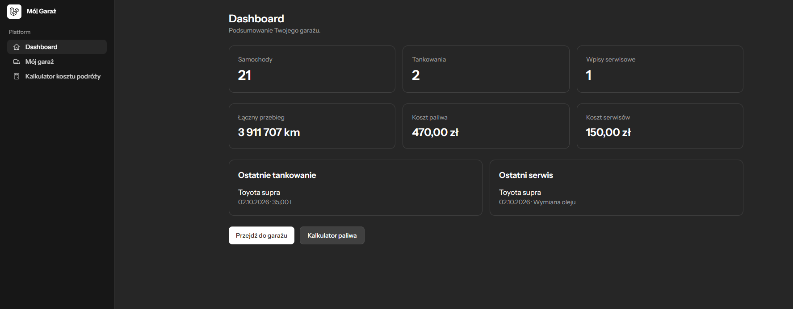
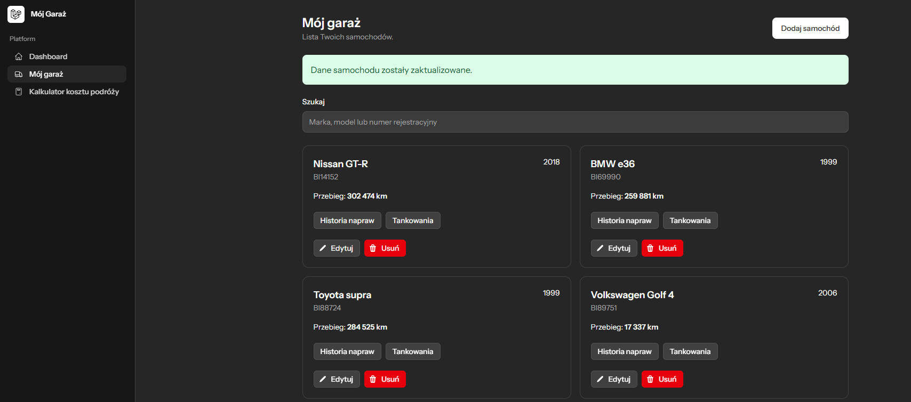
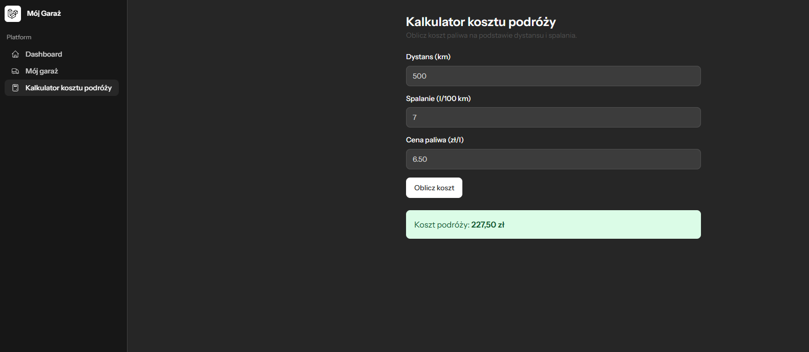

# Garage Manager — aplikacja testowa Livewire

> Projekt powstał w celach edukacyjnych i testowych, aby poznać oraz przećwiczyć działanie Laravel Livewire, Livewire Volt i Flux UI.

Garage Manager to prosta aplikacja do zarządzania samochodami, historią serwisową i tankowaniami. Zawiera również dashboard z podsumowaniem kosztów oraz kalkulator kosztu podróży.

## Podgląd aplikacji

### Dashboard



### Mój garaż



### Kalkulator kosztu podróży



## Funkcjonalności

### Konto użytkownika

- rejestracja i logowanie,
- resetowanie hasła,
- weryfikacja adresu e-mail,
- edycja profilu i zmiana hasła,
- wybór wyglądu aplikacji,
- usuwanie konta.

### Dashboard

Dashboard prezentuje podsumowanie danych zalogowanego użytkownika:

- liczbę samochodów,
- liczbę tankowań,
- liczbę wpisów serwisowych,
- łączny przebieg pojazdów,
- całkowity koszt paliwa,
- całkowity koszt serwisów,
- ostatnie tankowanie,
- ostatni wpis serwisowy.

### Mój garaż

Użytkownik może:

- dodawać samochody,
- edytować dane samochodów,
- usuwać samochody,
- wyszukiwać pojazdy po marce, modelu lub numerze rejestracyjnym,
- przeglądać listę pojazdów z paginacją.

Dla każdego pojazdu przechowywane są:

- marka,
- model,
- rok produkcji,
- przebieg,
- numer rejestracyjny,
- rodzaj paliwa.

Obsługiwane rodzaje paliwa:

- benzyna,
- diesel,
- hybryda,
- napęd elektryczny.

### Historia serwisowa

Każdy samochód może mieć własną historię serwisową. Wpis serwisowy zawiera:

- datę wykonania serwisu,
- przebieg pojazdu,
- rodzaj wykonanej usługi,
- opis,
- koszt,
- opcjonalną datę następnego serwisu.

Użytkownik może dodawać, edytować i usuwać wpisy serwisowe.

### Historia tankowań

Dla każdego samochodu można prowadzić historię tankowań zawierającą:

- datę tankowania,
- aktualny przebieg,
- liczbę zatankowanych litrów,
- cenę za litr,
- informację, czy zatankowano do pełna,
- automatycznie obliczony koszt tankowania.

Użytkownik może dodawać, edytować i usuwać tankowania.

### Kalkulator kosztu podróży

Kalkulator oblicza przewidywany koszt paliwa na podstawie:

- długości trasy,
- średniego spalania,
- aktualnej ceny paliwa.

Wykorzystywany wzór:

```text
koszt = (dystans / 100) × spalanie × cena paliwa
```

### Bezpieczeństwo danych

Dane są przypisane do zalogowanego użytkownika. Polityki autoryzacji uniemożliwiają przeglądanie i modyfikowanie pojazdów należących do innych użytkowników.

Usunięcie samochodu powoduje również usunięcie powiązanych z nim tankowań i wpisów serwisowych.

## Technologie

- PHP 8.2+
- Laravel 12
- Livewire Volt
- Flux UI
- Tailwind CSS 4
- Vite 6
- SQLite
- PHPUnit

## Wymagania

Przed uruchomieniem projektu należy zainstalować:

- PHP 8.2 lub nowszy,
- Composer,
- Node.js i npm,
- rozszerzenie PHP obsługujące SQLite.

## Instalacja

Sklonuj repozytorium i przejdź do katalogu projektu:

```bash
git clone ADRES_REPOZYTORIUM
cd livewire-app
```

Zainstaluj zależności PHP i JavaScript:

```bash
composer install
npm install
```

Utwórz plik konfiguracyjny środowiska:

```bash
cp .env.example .env
```

W systemie Windows można użyć:

```powershell
Copy-Item .env.example .env
```

Wygeneruj klucz aplikacji:

```bash
php artisan key:generate
```

Utwórz pusty plik bazy danych:

```text
database/database.sqlite
```

Następnie wykonaj migracje i uruchom seedery:

```bash
php artisan migrate --seed
```

## Uruchomienie

Całe środowisko deweloperskie można uruchomić poleceniem:

```bash
composer run dev
```

Polecenie uruchamia:

- serwer aplikacji Laravel,
- proces kolejki,
- serwer deweloperski Vite.

Aplikacja będzie dostępna domyślnie pod adresem:

```text
http://127.0.0.1:8000
```

## Testowe konto

Po wykonaniu `php artisan migrate --seed` dostępne jest konto:

```text
E-mail: test@example.com
Hasło: password
```

Dane służą wyłącznie do lokalnego testowania aplikacji.

## Testy

Testy automatyczne można uruchomić poleceniem:

```bash
php artisan test
```

Projekt zawiera testy między innymi dla:

- uwierzytelniania,
- ustawień konta,
- kalkulatora kosztu podróży,
- dodawania, edytowania, wyszukiwania i usuwania pojazdów,
- autoryzacji dostępu do pojazdów,
- obsługi historii serwisowej.

## Struktura najważniejszych elementów

```text
app/
├── Enums/                 # Typy paliwa
├── Livewire/Forms/        # Formularze Livewire
├── Models/                # Modele danych
├── Policies/              # Autoryzacja dostępu
└── Services/              # Serwisy aplikacji

resources/views/
├── livewire/automotive/   # Kalkulator kosztu podróży
├── livewire/vehicles/     # Zarządzanie samochodami
├── livewire/refuelings/   # Historia tankowań
├── livewire/service-records/ # Historia serwisowa
└── livewire/settings/     # Ustawienia konta

tests/
├── Feature/               # Testy funkcjonalne
└── Unit/                  # Testy jednostkowe
```

## Charakter projektu

Projekt ma charakter demonstracyjny i edukacyjny. Jego głównym celem jest testowanie reaktywnych komponentów Livewire, formularzy, walidacji, nawigacji bez pełnego przeładowania strony, autoryzacji oraz operacji CRUD w Laravelu.

## Licencja

Projekt bazuje na Laravel Livewire Starter Kit, udostępnianym na licencji MIT.